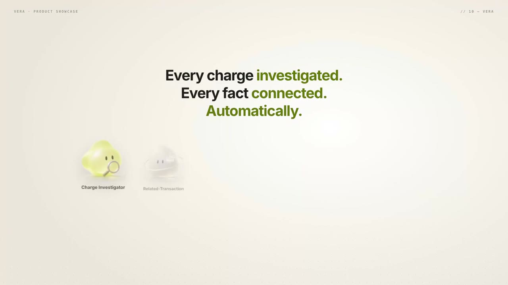

# Vera

Vera is an investigation workspace for disputed corporate-card charges. When a cardholder reports a charge they do not recognise, Vera opens a case, gathers the source records, runs a team of LLM agents on NVIDIA-hosted models that read the evidence and reason over it, asks the cardholder targeted questions, verifies identity, places an analyst-approved verification call, prepares a decision packet for a reviewer, and carries the approved outcome through provisional credit, dispute, card controls, the final message and closure.

Each specialist is an LLM-powered, tool-constrained agent that reads scoped evidence, produces structured findings, and hands work to the next workflow step. The models interpret evidence and recommend actions; deterministic policy checks and human approvals control anything consequential.

[](media/vera-launch.mp4)

[Watch the launch video](media/vera-launch.mp4) (2:19)

## Features

- Case intake, evidence gathering and a single derived case state for every charge report
- Nine LLM specialists for investigation, cardholder follow-up, decision and dispute packets, and prevention
- Cardholder questions, one-time-code identity checks and consented voice verification calls
- Reviewer approval bound to the evidence snapshot and policy version
- Provisional credit, network dispute, card controls and closure through simulated adapters
- Role-based views for the analyst, reviewer, card admin and cardholder
- Full audit trail of every command and agent step

## Architecture

```
Next.js UI ──► FastAPI command gateway ──► PostgreSQL
                   │                         ▲
                   │ role → schema → idempotency → version → step → policy → approval → effect
                   ▼                         │
            Worker (Postgres job queue) ── LangGraph (checkpointed) ── SpecialistRunner
                                                                      ├─ Model client: live | replay
                                                                      └─ Tool gateway (scoped evidence reads)
            Policy Controller (pure, deterministic)      Simulated adapters (messaging, OTP, voice, credit, dispute, card controls)
```

- Every change is a typed, role-checked, versioned, idempotent command, recorded as an audit event.
- A case's state and step are derived from stored facts by one function; nothing else writes them.
- Specialist output never changes state directly. It is validated against its schema and against the evidence it cites, then stored through service commands.
- Policy is a pure function of the evidence snapshot and the policy version. Credit requires an eligible policy result and a reviewer approval bound to the current evidence snapshot, policy version and workflow version.
- Live model failures are explicit. A recorded response is used only when an analyst retries a step in replay mode, and the step is labelled as replayed.
- One-time codes are never stored or shown to staff; only a keyed hash is kept.

### Specialists

| Specialist | Responsibility |
|---|---|
| Charge Investigator | Checks the charge against the purchase order, delivery and card records |
| Related Transaction Investigator | Finds other charges at the merchant that belong to the same pattern |
| Receipt Document Reviewer | Checks the receipt against the order and what was received |
| Cardholder Follow-up | Drafts targeted questions for the cardholder from the open findings |
| Response Reviewer | Classifies the cardholder's reply against each finding |
| Live Verification Agent | Extracts the answers given on the verification call, grounded in the transcript |
| Decision Packet Preparer | Writes the cited summary and recommendation a reviewer decides on |
| Dispute Packet Preparer | Selects the network reason code and writes the cited dispute narrative |
| Prevention Planner | Recommends card controls that would stop a repeat |

Each specialist runs in a tool-calling loop. The model chooses which evidence fields to read through a scoped tool gateway (up to four rounds) and returns typed findings. Every finding must cite fields the agent actually read; output that fails its schema or cites evidence it never read is rejected and the agent is re-prompted with the reason (up to two retries).

### Workflow orchestration

Workflows are versioned node and edge definitions compiled to LangGraph `StateGraph`s and checkpointed in Postgres, so a run resumes where it stopped after a worker restart. The investigation graph runs two specialists in parallel and joins before the receipt review and policy check:

```
            ┌─► Charge Investigator ──────────────┐
  start ────┤                                     ├─► Receipt Document Reviewer ─► Policy check ─► end
            └─► Related Transaction Investigator ─┘
```

The verification call is a separate graph that pauses on an `interrupt` after the analyst approves the questions and the cardholder consents, and resumes only when the provider's signed webhook delivers the transcript. The remaining specialists run as jobs on the Postgres-backed queue as the case reaches each step.

### Models

Specialists call `meta/llama-3.3-70b-instruct` through NVIDIA's OpenAI-compatible API by default, using tool calling and JSON-mode output. Any model on the NVIDIA API can be selected with `VERA_MODEL_ID`, and `VERA_BASE_URL` points the client at a self-hosted NIM container so card data can stay inside the operator's own infrastructure. Each step records the model id it ran on.

## Getting started

### Prerequisites

- Python 3.12 with [uv](https://docs.astral.sh/uv/)
- Node 22
- PostgreSQL 16

### Run the demo

```bash
infra/dev-db.sh start      # local Postgres on 127.0.0.1:54329 (or point VERA_DATABASE_URL at your own)
infra/demo.sh up           # migrate, seed, start API :8300, worker and web :3300 in replay mode
open http://127.0.0.1:3300/cases
infra/demo.sh reset        # fresh seed between takes
infra/demo.sh down
```

The demo case is **CHG-1042 · Northstar Equipment · $2,840.00** (synthetic): Priya Shah does not recognize a charge on the card ending 4418; PO-219 approved one pump for $2,400.00, DLV-882 records two units received, and there is no receipt, a $440.00 discrepancy. Switch roles with **Viewing as …** in the top bar:

| Role | Person |
|---|---|
| Finance analyst (also ops admin) | Sam Rivera |
| Reviewer, card admin | Dana Okafor |
| Cardholder | Priya Shah |

If Postgres binaries are not in `/usr/lib/postgresql/16/bin`, set `VERA_PGBIN`. With Docker: `docker compose -f infra/docker-compose.yml up`.

### Live model

By default the demo runs in replay mode, which feeds each specialist a reference recording from `evals/recordings/` through the same loop and validators, so it is repeatable and needs no key. To run the specialists against the live model:

```bash
export NVIDIA_API_KEY=... VERA_MODEL_ID=meta/llama-3.3-70b-instruct
uv run python -m vera_api.model_client probe   # checks JSON-mode and tool-call support
NVIDIA_API_KEY=$NVIDIA_API_KEY infra/demo.sh live
```

### Voice verification

The verification call uses an ElevenLabs voice agent over Twilio or SIP. In the synthetic environment a simulated provider drives the same webhook path. For real calls set `VERA_VOICE_PROVIDER=elevenlabs`, `ELEVENLABS_API_KEY`, `ELEVENLABS_AGENT_ID`, `ELEVENLABS_AGENT_PHONE_NUMBER_ID`, `ELEVENLABS_WEBHOOK_SECRET` (and `ELEVENLABS_TELEPHONY=sip` for SIP trunks; Twilio is the default), configure one data-collection item per approved question on the agent, and point its post-call webhook at `<public API origin>/api/webhooks/voice/elevenlabs`.

## Evaluation

`uv run python -m evals.harness` replays 47 synthetic evaluation cases against the real gateway, worker and database in replay mode, then writes [`artifacts/eval-report.md`](artifacts/eval-report.md). Each case declares its evidence, specialist outputs, policy result, workflow state, allowed and forbidden commands, audit events and final outcome, and deterministic evaluators check every one. Global invariants run after every case:
- the stored state equals what `derive_step` derives;
- the audit trail is append-only;
- no specialist moves money;
- credit only behind a reviewer approval bound to the current evidence;
- every effect happens exactly once.

The run also removes safeguards one at a time and confirms that the suite catches each. See [docs/evaluation.md](docs/evaluation.md) for the method and findings, and [docs/evaluation-cases.md](docs/evaluation-cases.md) for the cases.

## Configuration

See `.env.example`. Settings are read from the environment; export them before running.

## Development

```bash
uv sync
uv run ruff check . && uv run mypy packages services
uv run alembic upgrade head
uv run pytest -q
uv run python -m evals.harness        # regression scenarios + 47 evaluation cases; writes artifacts/eval-report.{json,md}

cd apps/web && npm ci
npm run typecheck && npm run lint && npm test && npm run build
```

## Project structure

| Path | Contents |
|---|---|
| `packages/domain` | Domain types, commands, state derivation, policy, specialist specs |
| `services/api` | FastAPI app, command gateway, features, worker, model client |
| `infra` | Migrations, local Postgres, demo script, containers |
| `apps/web` | Next.js app; `apps/web/prototype` is the original design prototype |
| `evals` | Evaluation harness, evaluators, report, shared journeys and reference recordings |
| `tests` | Unit, integration, contract and evaluation tests; `tests/fixtures/eval_cases` holds the evaluation cases |
| `docs` | Evaluation method and case catalogue |
| `artifacts` | Latest evaluation report (generated) |
| `media` | Launch video |
