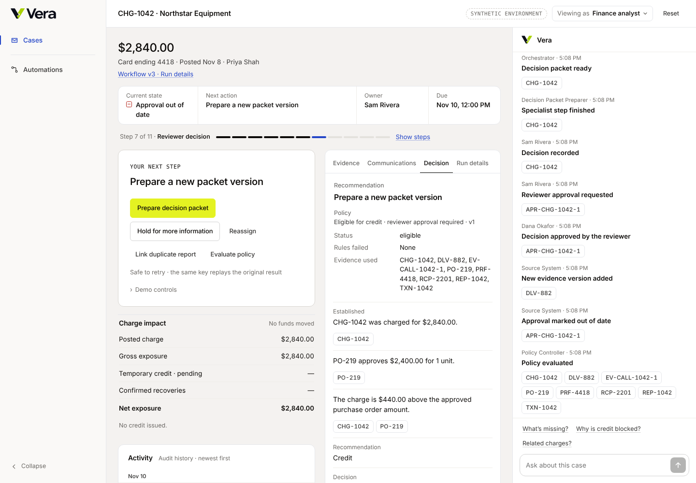
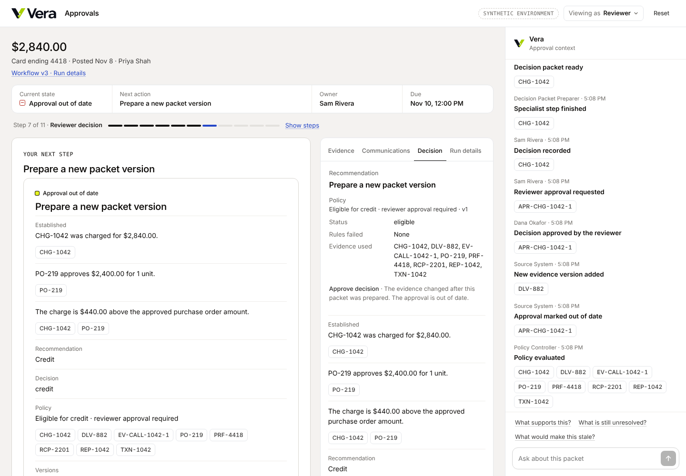

# The financial-action invariant

> No provisional credit, dispute submission or card-control application runs on a stale
> approval, outdated evidence, or a policy or workflow version other than the one the case is
> pinned to. The backend enforces this inside the transaction that calls the adapter. Hiding a
> button in the UI is not what stops it.

This page states the rule, shows where it is enforced, lists what the audit found and fixed, and
explains how to check it yourself.

## The rule

A provisional credit runs only when **all** of the following hold, checked inside one database
transaction that holds the case row lock, immediately before the credit adapter is called:

| Condition | Checked against |
|---|---|
| A reviewer approval exists and is `approved`, not `stale`, `returned` or already consumed | the approval for the current decision packet |
| The approval's evidence snapshot equals the case's current snapshot | `cases.evidence_snapshot` |
| The approval's policy version equals the case's pinned policy version | `cases.policy_version` |
| The approval's workflow version equals the case's pinned workflow version | `cases.workflow_version` |
| The approval is for this transaction | `cases.transaction_id` |
| The approved decision is a **credit**, and the amount credited equals the charge amount in the approved evidence | the decision; `CHG-1042.amount_cents` at the current version vs the posted transaction |
| The stored policy result for the current snapshot is eligible, **and** a fresh evaluation in the same transaction agrees | `policy_evaluations`, then `policy.compute` |
| The actor holds the analyst role, re-checked against `user_roles` | the session cookie is not trusted |

A dispute is submitted only on a packet the analyst reviewed **on the current snapshot**. Card
controls are applied only under a card-admin approval given **on the current snapshot**.

A material change invalidates the approval in the same transaction as the change: the approval
is marked `stale`, an `approval.stale` audit event is written, and the case moves to
`decision_pending/stale` ("Approval out of date"). The approval can't be reused. The way forward
is a new decision packet on the current evidence, a new decision, a new request and a new
reviewer approval.

## Where it is enforced

| Layer | What it does | Source |
|---|---|---|
| Gateway gate order | role → schema → key replay → case version → closed → step → **policy (7)** → **approval binding (8)** → record guard → server-resolved key → effect, all after `SELECT … FOR UPDATE` on the case row | [`gateway._execute`](../services/api/vera_api/gateway.py#L475), [`_lock_case`](../services/api/vera_api/gateway.py#L302) |
| Pure gates | `policy_gate` and `approval_gate` compare the stored result and the approval's binding with the case's current pins | [`commands.py`](../packages/domain/vera_domain/commands.py#L520) |
| **Credit boundary** (new) | The credit effect re-runs both gates, re-evaluates policy live, and checks the decision scope and the amount before calling the adapter. It doesn't rely on its caller: `write_command` (stage 9) re-runs only the closed and step gates. | [`money._authorize_credit`](../services/api/vera_api/money.py#L141), called from [`_issue_effect`](../services/api/vera_api/money.py#L115) |
| Approval lifecycle | Bound at request time to the packet's snapshot, policy version and workflow version. Approve refuses on a mismatch. Consumed by the credit execution it authorized. | [`decisions._request_approval`](../services/api/vera_api/decisions.py#L422), [`_approve`](../services/api/vera_api/decisions.py#L451), [`mark_approval_consumed`](../services/api/vera_api/decisions.py#L145) |
| **Invalidation on every evidence write** (fixed) | Every evidence service command recomputes the snapshot and runs the stale hook in the same locked transaction, then emits `approval.stale` and re-evaluates policy. | [`evidence.run_effect`](../services/api/vera_api/evidence.py#L643), [`after_effect`](../services/api/vera_api/evidence.py#L576), [`decisions._mark_stale`](../services/api/vera_api/decisions.py#L130) |
| **Dispute and controls binding** (new) | The review and the card-admin approval record the snapshot they were given on. Submit and apply refuse if it has moved. The packet can be reviewed again, or the plan approved again. | [`money._submit_effect`](../services/api/vera_api/money.py#L396), [`_apply_effect`](../services/api/vera_api/money.py#L508), [`_review_effect`](../services/api/vera_api/money.py#L362), migration [`0020`](../infra/migrations/versions/0020_execution_binding.py) |
| Exactly once | One credit row per case and transaction (unique). The adapter runs once per idempotency key, and a succeeded or uncertain key replays instead of calling the adapter again. | [`adapters.execute`](../services/api/vera_api/adapters.py#L86) |
| Append-only history | Postgres triggers refuse `UPDATE` and `DELETE` on audit events, transitions, evidence versions, decisions and packets. | `infra/migrations/versions/0001_baseline.py` and later |

### Why races can't slip through

Every write to a case goes through the gateway and starts by locking the case row. That covers
evidence changes, approvals, credits, disputes and controls. The approval check, the policy check,
the boundary re-check, the adapter call and the approval's consumption all run in one transaction
under that lock. An evidence change that races a credit therefore runs entirely before or entirely
after it:

- **Change first:** the credit waits on the lock, then reads the new snapshot. The approval is
  already `stale`, and the credit is refused without calling the adapter. Test 8.
- **Credit first:** the approval is consumed by that execution and is never re-marked stale. The
  later change can't undo money that legitimately moved. Test 8b.

## What the audit found

| # | Finding | Severity | Before the fix | Fix |
|---|---|---|---|---|
| A | `record_finding` and `link_evidence` never recomputed the snapshot, so a conflict recorded after approval left the snapshot, the stored policy result and the approval looking current | **Money bypass** | With a new open conflict on the register, the credit was **issued** (reproduced: `200 credit_status: issued`) | Every evidence write recomputes the snapshot and invalidates bound approvals in the same transaction |
| B | `set_record_status` and `resolve_finding` changed the snapshot without running the stale hook | Audit and UI gap (money was still refused by the binding gate) | The approval stayed `approved`, with no `approval.stale` event and a misleading state | Same fix as A |
| C | Dispute submission wasn't tied to the evidence the packet was reviewed on | Stale financial action | The dispute was **submitted** on a packet reviewed before the evidence changed | Review binds the snapshot; submit refuses with `dispute_review_stale` |
| D | Card-control application wasn't tied to the evidence the card admin approved on | Stale action | Controls were **applied** under an approval given on older evidence | Approve binds the snapshot; apply refuses with `controls_approval_stale` |
| F | Open conflicts entered the snapshot hash by finding id, and those ids embed random run ids, so the same evidence hashed differently on every replay | Determinism (found when fix A moved the recompute earlier and the enabled-actions contract test broke) | A key advertised from one replay of the journey was rejected on the next | Conflicts are hashed by content: the conflict field plus the exact record versions and fields cited |
| E | The credit effect relied on the gateway's stages 7–8 having run before it | Defense in depth | With a mismatched binding, `write_command` **issued** the credit | `_authorize_credit` runs inside the effect |

Gaps A–E each have a test that fails on the code before the fix and passes after it (F is covered by `tests/contract/test_enabled_actions.py`). To see it,
stash the three changed service files and rerun the test file: 5 tests fail. Restore them: all 19
pass.

**Already correct (not rebuilt):**
- the gate order and row locking;
- binding at approve and at issue;
- stale marking on material version changes;
- re-approval of a stale approval refused;
- idempotent replay;
- exactly-once adapters with a lookup path for uncertain results;
- server-side role re-check;
- append-only triggers.

## Tests

[`tests/integration/test_approval_invariant.py`](../tests/integration/test_approval_invariant.py)
runs against real Postgres through the real gateway, driving the golden CHG-1042 journey with the
shared fragments in `evals/fragments`. For every refused attempt it checks:
- the refusal code;
- no credit, dispute or control persisted;
- no successful adapter execution;
- no state transition and no change to the case version, event count or idempotency rows;
- the audit event that explains the refusal.

A refused command itself writes nothing, by design of the gateway.

| # | Scenario | Test | Refused with |
|---|---|---|---|
| 1 | Valid evidence → eligible → approved → credit succeeds exactly once; the same request replays | `test_1_…` | n/a |
| 2 | Approval granted → evidence changes → credit refused; the reviewer can't approve the stale approval | `test_2_…` | `invalid_step`, `approval_stale` |
| 3 | Approval granted → case re-pinned to another policy version → credit refused | `test_3_…` | `policy_blocked` |
| 4 | Approval granted → case re-pinned to another workflow version → credit refused | `test_4_…` | `approval_stale` |
| 5 | Reviewer, card admin, cardholder or ops admin tries to issue | `test_5_…` (×4) | `role_forbidden` |
| 6 | The hidden action is posted directly, with the old UI key and with a guessed current key | `test_6_…` | `invalid_step` |
| 7 | The approve request is replayed after invalidation: replays its old answer and changes nothing. A failed credit retried after invalidation never reaches the adapter | `test_7_…`, `test_7b_…` | `invalid_step` |
| 8 | An evidence change and the credit race on the case lock: no credit commits against the stale approval. The opposite order consumes the approval | `test_8_…`, `test_8b_…` | `stale_case_version` / `invalid_step` |
| 9 | New packet, new decision, fresh approval → credit succeeds once, bound to the new snapshot | `test_9_…` | n/a |
| A–E | The gaps above | `test_gap_a_…` … `test_gap_e_…` | `invalid_step`, `dispute_review_stale`, `controls_approval_stale`, `approval_stale` |

**Version changes (tests 3 and 4).** No product command re-pins a live case. Publishing a new
policy or workflow version only affects new cases; existing cases keep their pinned versions.
Those two tests therefore change the case's pin with SQL, the one thing in this file not done
through a command, and then attempt the credit through the real gateway.

**Evaluation cases.**
- [EC-25](../tests/fixtures/eval_cases/EC-25_stale_approval_after_approval.json) is the demo below.
  It also checks what the UI reads: the state label, the reviewer's blocked-action reason, and
  the `approval.stale` entry in the audit trail.
- [EC-48](../tests/fixtures/eval_cases/EC-48_late_conflict_invalidates_approval.json) replays gap A.
- The global invariant `financial_safety.credit_requires_bound_approval` runs after all 48 cases.
  It checks that every credit has an approval bound to the snapshot, policy version and workflow
  version the case had at that moment.

## Demo: stale approval blocks a credit

```bash
infra/dev-db.sh start
uv run python -m evals.harness --suite cases --only EC-25   # the scenario, asserted end to end
uv run pytest -q tests/integration/test_approval_invariant.py
```

To see it in the app: run `infra/demo.sh up`, take CHG-1042 to reviewer approval, then post
`/api/demo/material-change` with `{"record_id": "DLV-882"}`, which corrects the delivery to 1
unit. Then open the case:

1. Investigation completes and the reviewer approves a $2,840.00 provisional credit (`APR-CHG-1042-1`).
2. Before the credit is issued, the delivery record DLV-882 changes from 2 units to 1.
3. The approval is marked out of date in the same transaction, and the policy is re-evaluated.
4. The previously approved credit is attempted. The request built before the change gets
   `409 stale_case_version`; a fresh request gets `409 invalid_step`. The credit adapter is never called.
5. The case shows **Approval out of date**, with next action **Prepare a new packet version**.
   The reviewer's *Approve decision* is blocked with "The evidence changed after this packet was
   prepared. The approval is out of date." The activity feed shows **New evidence version added →
   Approval marked out of date → Policy evaluated**, and charge impact shows **No funds moved**.
6. A new packet, decision and approval (`APR-CHG-1042-2`) are bound to the new snapshot.
7. The credit is issued once.




## Simulated adapters vs real providers

The credit, dispute and card-control adapters in this repository are **simulated**.

**What the code guarantees.** The guarantees above hold for any adapter behind
`adapters.execute`:
- no adapter call happens unless every check passed in the same locked transaction;
- one idempotency key runs the effect at most once, and a succeeded or uncertain key never
  re-dispatches;
- an uncertain result is settled by lookup, never by a second call.

**What a real provider must also provide.** These are outside this repository:
- **Idempotency keys:** the provider must honour them (Vera sends the same key on every retry),
  or Vera needs a reconciliation feed.
- **Commit atomicity:** Vera's transaction and the provider's side effect can't be committed
  atomically. If the adapter succeeds and Vera's commit then fails, Vera keeps no record of the
  call. The same key is sent on retry, so a provider that de-duplicates by key won't move money
  twice. One that doesn't would need an outbox or reconciliation job, which isn't built.
- **Holding the lock during the call:** a real provider call happens while the case row is
  locked. That is safe, but a slow provider blocks other commands on that case; a production
  version would need provider timeouts.

## Remaining limitations

- **No amount column on the approval.** The approval binds the action through the recorded
  decision and binds the amount through the evidence snapshot (the charge record's amount is part
  of it). The amount itself is compared with the posted transaction at execution.
- **Version re-pins are untested through a product path.** None exists; the tests simulate one
  with SQL.
- **Hidden actions don't explain themselves on screen.** Dispute and controls actions stay hidden
  while they can't run, which is the existing UI convention. A stale review or approval shows up
  as *Review packet* or *Approve controls* reappearing; the explicit reason is in the API refusal.
- **Rejected attempts are not audit events.** The gateway writes nothing for a refused command.
  The audit trail records why it would be refused (the `approval.stale` event), not each attempt.
